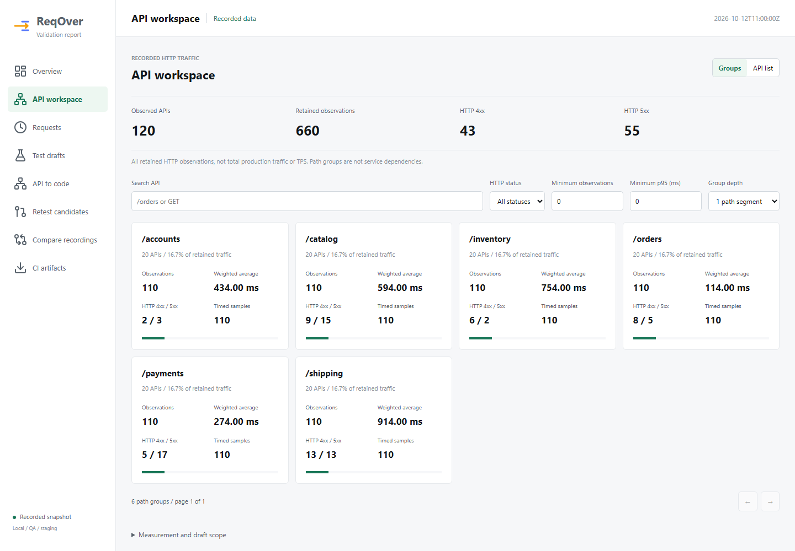
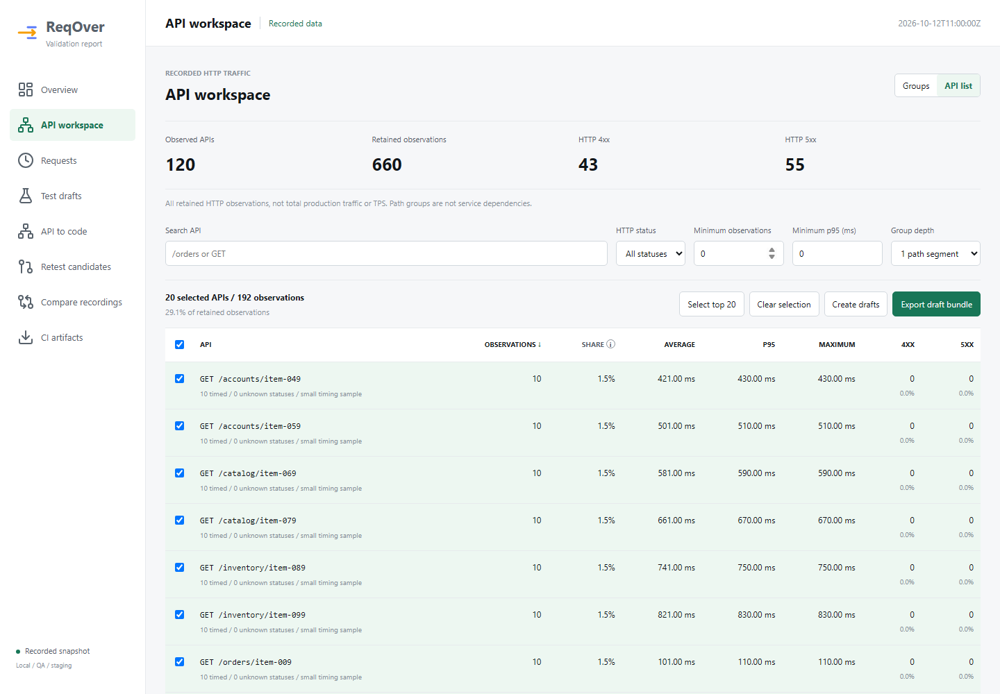

**English** | [한국어](34_api_workspace.ko.md) | [Documentation](README.md)

# API Workspace (Unreleased)

Available in this source branch, not in the published 0.4.2 artifacts. This adds
an offline API selection workspace without changing collectors, coverage JSON,
CLI commands, the CI Action contract or the existing relationship maps.

## Views





These initial-iteration screenshots are actual renderer output over a synthetic 120-API/660-observation
fixture, not production evidence or a performance benchmark. Both groups and API
rows paginate at 20 items to avoid unbounded DOM growth. Newly added reset/group-context
and source-availability controls are not pictured; see the [usability follow-up](35_dashboard_usability_review.md).

**Groups** combines API routes by the first one, two or three path segments.
Choose deeper grouping for `/api/v1/...`. These are path groups, not discovered
services or dependency clusters. Search/status/count/p95 filters narrow the
group summaries; top-level totals remain fixed for the recording.

**API list** shows retained observations and share, average/p95/maximum adapter
intervals, timed sample counts, unknown statuses and 4xx/5xx counts/percentages.
Click a column heading to sort. Missing timing sorts last in either direction.
Reset filters clears search/status/count/p95 and group restriction without clearing
selection, sort order or group depth. Clear group removes only the path-group restriction.
Twenty API rows are rendered per page; checkboxes preserve selection across
pages, filters and views. Select top 20 adds the first 20 matching APIs in the
current sort order; it does not discard previous selections. Clear selection
removes all selections. Clicking a group narrows the list; Groups clears that
group restriction. Clicking an API opens its observed code through the existing filter.

## Test Target Selection

Selection reports the number of API names and their share of retained HTTP
observations, including selected names hidden by filters. Frequency is only one
signal: a rarely called authorization or payment endpoint can still be critical.
Percentages for HTTP errors use known final statuses, not total observations or
test assertions. A 4xx may be expected. Unknown statuses are shown explicitly.

Create drafts opens the existing editor with one latest available detail per
selected API. Concrete path, expected status, authentication and timing expectations
are not guessed. Review each draft independently; JUnit remains disabled by default.
Repeated creation reuses drafts with the same endpoint, request ID and start time,
preserving reviewed edits. Available/missing detail counts are shown before creation;
the editor reports new versus reused drafts.

Export draft bundle produces `reqover-http-test-draft-bundle`, schema 1:
`selectedEndpoints`, `drafts`, `missingSourceEndpoints`, `sourceDetailLimit: 100`,
`state: review-required`, `replayable: false` and the source report's `generatedAt`.
This bundle is not CLI coverage JSON, not a comparison summary, not Postman/JMeter
format and not an executed test result. It currently has no bundle import action.

Statistics use the existing Java-computed summary of all retained HTTP observations.
Draft sources use the map's latest 100 details. An API can have valid statistics
without available detail; those names are explicitly listed as missing in the bundle.
The 120-API/660-observation synthetic browser fixture exports 16 representative
drafts and lists 104 missing source APIs; it never manufactures the other requests.

## Measurement and Safety

Group averages are sums of valid intervals divided by timed samples, not the
unweighted mean of API averages. Group p95 is deliberately absent: combining
endpoint percentiles cannot produce a group percentile. Intervals are not CPU,
network latency or whole-service TPS. Exported coverage JSON may already have a
truncated detail window; rendering that file cannot recover omitted observations.

Selection/drafts are page-local and disappear on reload. Exports can contain
private endpoint/code names; do not publish automatically. No requests are replayed,
no production traffic is blocked and no external assets or analytics are loaded.
Without JavaScript, original static tables remain available and this workspace stays hidden.

## Verification and Troubleshooting

```bash
./gradlew :reqover-report:test :reqover-cli:test :reqover-cli:shadowJar
node --test scripts/api-workspace.test.cjs scripts/recording-comparison.test.cjs scripts/test-case-drafts.test.cjs
node scripts/verify-api-workspace.cjs path/to/120-api-fixture.html
```

Browser checks exercise 120 APIs, 660 observations, group drill-down, sorting,
selection across pages/filters, missing-source exports, independent draft review,
code navigation, and 1920/1280/760/390px layouts. Existing map/draft/comparison,
legacy and no-script behaviors are separately regression-tested.

- Legacy report has no request diagnostics: show unavailable rather than inventing API timing.
- Legacy global tables give their first column 40% width: override only `.api-table`
  layout/column widths, with a browser assertion on the checkbox column.
- ISO timestamp fractions vary in length: compare actual instants and nanosecond
  fractions when choosing a representative, not lexicographic strings.

Five-minute windows and the heatmap are now part of the unreleased [scale views](37_scale_views.md).
Persistent history, replay and external scenario formats remain follow-up work.
